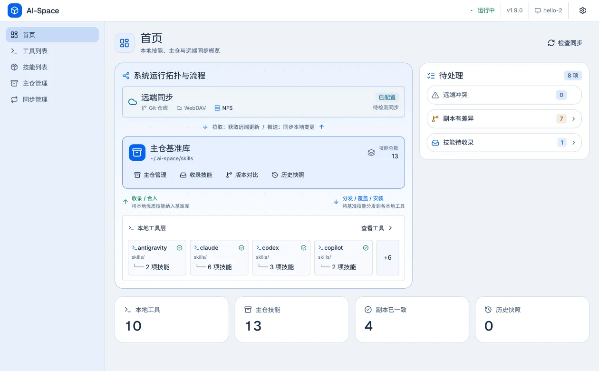
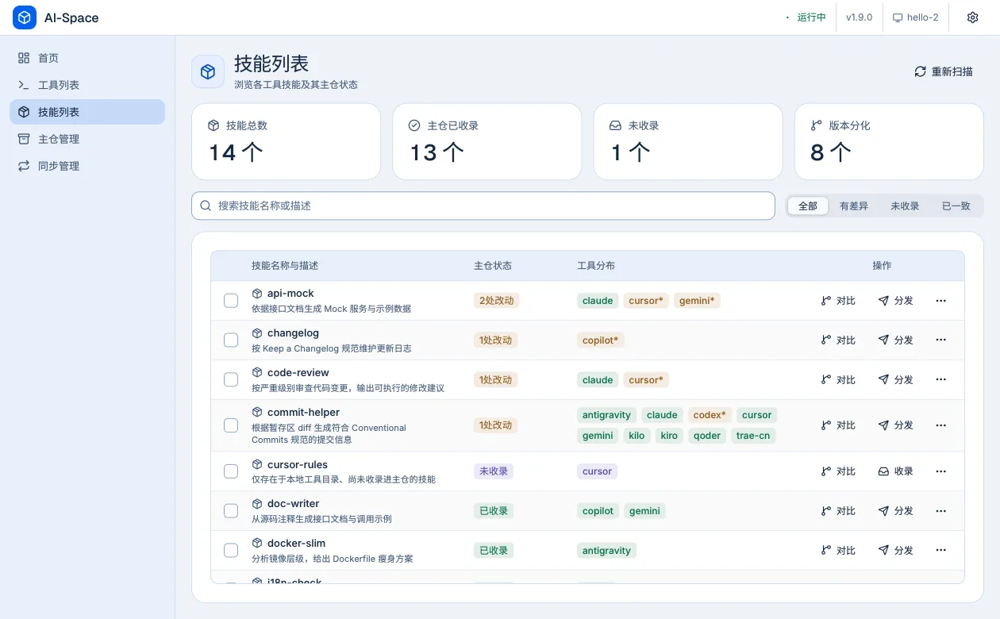
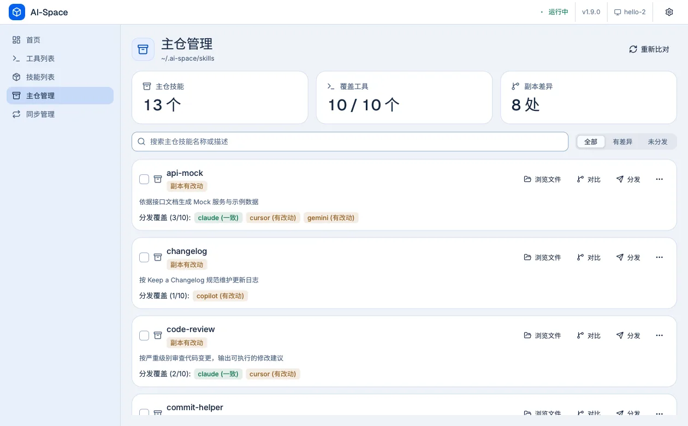
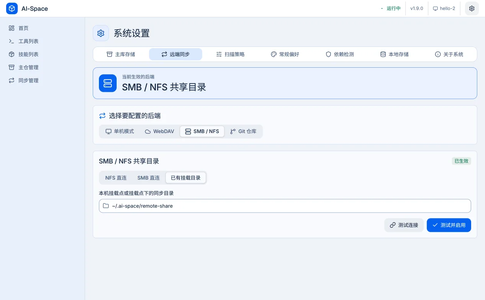
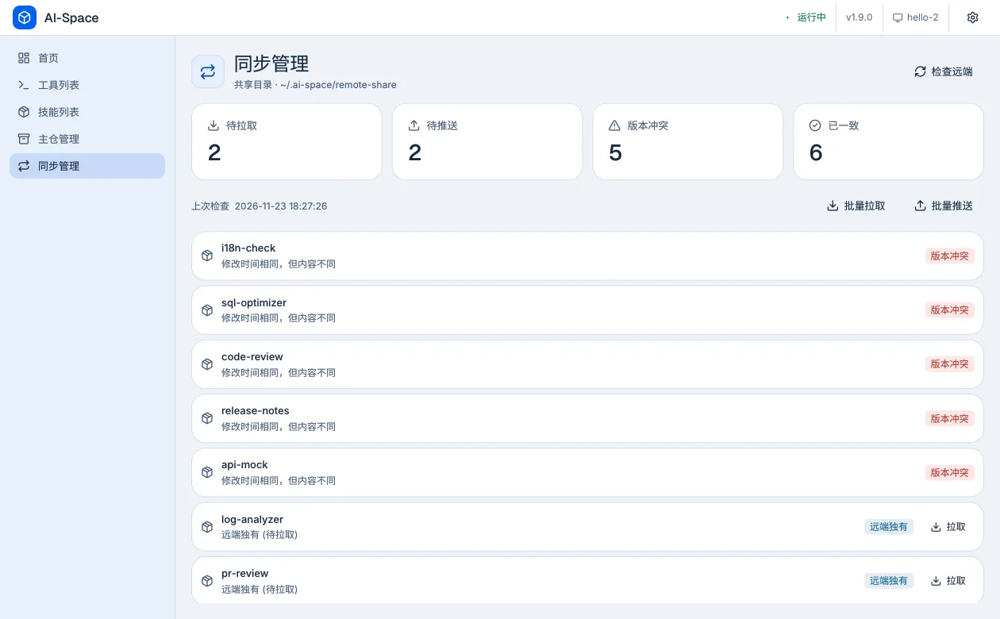

# SkillBoard

> **本地优先的多智能体技能与主仓集中同步管理工作台**  
> *Local-First Agent Skills Manager & Multi-Host Synchronization Hub*

SkillBoard 是一款专为 AI 编码助手（如 Claude、Gemini CLI、Cursor、CodeX 等）打造的高性能本地技能管理与跨端同步工具。采用原生 C99 与轻量级 CUI 界面引擎构建，基于 SQLite3 提供强事务一致性持久化，拒绝软链接隐患，实现纯物理原子级文件分发与多主机同步。



---

## 🌟 核心特性

- **多工具本地技能自动扫描与识别**
  - 自动发现各工具目录（`~/.<tool>/skills`）下的 Skill，提取元数据并持久化到本地 SQLite。
  - 支持多维度搜索、列排序与状态统计。
  - 工具列表和工具详情页提供「清空」：确认后把该工具技能目录内的全部内容整体移入一份快照，目录本身保留。

- **集中主仓管理 (Master Hub) 与全景关系矩阵**
  - 以标准化主仓基准目录（默认 `~/.skillboard/skills`）作为唯一真相源。
  - 全景扫描各工具副本与主仓基准的关系矩阵，精准识别：**完全一致**、**本地改动**、**副本落后**、**主仓未收录** 等分化状态。

- **原子级代码差异比对与文件树可视化**
  - 统一平铺式文件管理器树形组件，直观标记新增、修改与删除文件。
  - 支持双栏分屏（Split Diff）与单栏行内（Inline Diff）差异比对，行级别统计改动。

- **纯物理复制与安全防御快照 (No Symlinks & Snapshot Backups)**
  - 坚持**拒绝软链接**原则，所有安装、采纳与广播均采用纯物理文件拷贝，彻底避免跨容器或多运行时环境下的软链接损坏。
  - 任何覆盖或删除操作前，自动在 `~/.skillboard/backups/` 创建带时间戳的完整快照，100% 可回溯。

- **主机无关的远端多后端同步管理 (Host-Agnostic Multi-Backend Sync)**
  - 抽象出不变的同步原语（`test_connection`、`fetch_remote_manifest`、`check_drift`、`pull_skill`、`push_skill` 等）。
  - 支持多种云端/局域网共享后端：
    - **WebDAV**（支持匿名和账号认证）
    - **SMB / NFS 共享目录**（使用操作系统已经挂载的目录）
    - **Git 远端版本库**（GitHub、GitLab、Gitea）
  - 多台主机配置同一个远端目标后，可在「同步管理」检查差异，再按项或批量拉取和推送。

- **现代化系统设置 (Tabbed Web-Style Settings)**
  - 类别涵盖：仓储与主库路径、远端同步后端激活与连通性测试、扫描策略与安全规则、常规界面偏好。





---

## 🚀 快速上手

### 环境要求
- macOS / Linux / Windows（跨平台）
- C 语言编译器（`clang` 或 `gcc`，支持 C99 标准）
- SQLite3 运行库（`-lsqlite3`）
- Linux 需要 X11 开发头文件（`libx11-dev`）；Windows 需 MinGW（MSYS2）；macOS 无额外依赖

### 编译构建
```bash
# 克隆仓库（含 CUI 子模块）
git clone --recursive https://github.com/weibaohui/skillboard.git
cd skillboard

# 方式一：本地 macOS 开发（Makefile）
make

# 方式二：跨平台构建（Linux / macOS / Windows，CMake）
cmake -S . -B build -G Ninja -DCMAKE_BUILD_TYPE=Release
cmake --build build --parallel
./build/skillboard
```

### 配置远端同步

在「系统设置 → 远端同步」选择后端，填好参数后点击「测试并启用」。



- **WebDAV** 使用包含服务路径的 HTTP(S) 地址。匿名模式留空账号和密码，认证模式填写账号和密码或应用授权码。同步子目录相对于服务地址填写，留空则使用该地址对应的目录。连接测试会创建缺失的同步子目录，并用临时文件验证读写与目录移动。运行时需要 `curl`。
- **NFS 直连** 填服务器 IP 或主机名和导出路径，例如 `nas.local`、`/srv/share`。使用 NFSv3，访问权限由服务端控制。
- **SMB 直连** 填服务器 IP 或主机名和共享名，例如 `nas.local`、`share`。访客模式留空用户名和密码，认证模式填写用户名和密码。客户端使用 SMB 2/3。
- 两种直连模式均可选填共享中已有的同步子目录，留空则使用共享根目录。SkillBoard 使用随包提供的 C 客户端库，直接通过网络收发文件。
- 已有 SMB / NFS 挂载目录仍可通过「已有挂载目录」使用。

多台主机配置同一个远端目标后，即可在「同步管理」检查两端差异，按项或批量拉取 / 推送：



可在 macOS 上用 `make test_sync_backends` 构建实测程序。它会在指定测试目录写入样本，请为远端和两个本地主仓分别准备空的测试目录。

```bash
./test_sync_backends shared /path/to/remote-fixture /tmp/hub-a /tmp/hub-b
./test_sync_backends webdav https://example.test/dav isolated-fixture /tmp/hub-a /tmp/hub-b
./test_sync_backends nfs nas.local /srv/share isolated-fixture /tmp/hub-a /tmp/hub-b
./test_sync_backends smb nas.local share isolated-fixture /tmp/hub-a /tmp/hub-b
```

本地存储与文件预览回归可运行 `make test_storage_preview && ./test_storage_preview`，清空工具技能目录可运行 `make test_tool_clear && ./test_tool_clear`。

测试认证 WebDAV 时，可通过 `AI_SPACE_TEST_WEBDAV_USER` 和 `AI_SPACE_TEST_WEBDAV_PASSWORD` 提供凭据。

### 自动化构建（GitHub Actions）
推送 / 打 tag 后，[build workflow](.github/workflows/build.yml) 会自动为以下平台矩阵编译并打包
（归档内含可执行文件与 CJK 字体 `fonts/`）：

| 平台 | 架构 | 产物形态 | 兼容下限 |
|---|---|---|---|
| Linux | x86_64 / arm64 | tar.gz + AppImage（内嵌 libsqlite3 等依赖） | **glibc 2.17**（zig cc 锁定符号基线，CentOS 7 / RHEL7 / Debian 7 / Ubuntu 12.04+ 均可运行） |
| macOS | arm64 / x86_64 / Universal2 | SkillBoard.app Bundle | macOS 10.13+（deployment target 与 Info.plist 对齐） |
| Windows | x86_64 / arm64 | zip | Windows 7+（win32 ABI 向后兼容） |

- Linux 二进制用 `zig cc -target <arch>-linux-gnu.2.17` 构建，glibc 符号版本与 runner 无关；
  CI 里还有一步 `objdump` 断言，防止基线意外上浮。X11/libGL 依赖目标系统的桌面栈（桌面发行版均自带）。
- 每次推送：产物上传为 workflow artifact（Actions 页面下载）；
- 推送 `v*` tag：产物自动附加到 GitHub Release。

> ⚠️ 运行时请保持可执行文件与 `fonts/` 目录相对位置不变（CJK 字体从相对路径加载，程序也会自动在可执行文件旁与 `~/.skillboard/fonts/` 查找）。

### 🎨 应用图标与 macOS App Bundle

图标源文件由 `assets/make_icons.py`（Pillow）生成，产出的 `assets/icon.icns`（macOS）、`assets/app.ico`（Windows，经 `assets/app.rc` 以资源 ID 1 编译进 exe，Dock/任务栏即显示图标）、`assets/icon_256.png`（Linux）随仓库提交，CI 直接取用。

- **macOS**：CI 把可执行文件、CJK 字体与图标打成 `SkillBoard.app` Bundle（Info.plist + icns + 临时签名），解压后双击即可像正常 App 一样从 Dock/启动台打开。CI 构建未经 Apple 公证，首次打开若被 Gatekeeper 拦截：右键 →「打开」，或执行
  `xattr -dr com.apple.quarantine SkillBoard.app`。正式分发可另用 Developer ID 签名 + 公证。
- **Linux**：归档内附 `com.weibaohui.skillboard.desktop` 与图标，安装到 `~/.local/share/applications/` 与 `~/.local/share/icons/hicolor/256x256/apps/` 后即可出现在应用列表/任务栏（程序已设置 `app_id`，窗口类名一致）。
- **Windows**：图标直接内嵌于 exe，无需额外文件。

---

## 📁 源码架构目录

```
skillboard/
├── include/                # 头文件与接口定义
│   ├── app_state.h         # 全局应用状态机模型
│   ├── sync_backend.h      # 远端同步后端抽象与原语 VTable
│   ├── hub_manager.h       # 主仓与工具副本关系矩阵
│   ├── db.h                # SQLite 本地持久化与配置表
│   ├── view_tools.h        # 工具列表视图
│   ├── view_master_hub.h   # 主仓集中管理视图
│   ├── view_hub_matrix.h   # 全景关系扫描矩阵视图
│   ├── view_hub_diff.h     # 代码差异比对视图
│   ├── view_sync.h         # 远端同步管理视图
│   └── view_settings.h     # 网页 Tab 风格系统设置
├── src/                    # 核心实现源码
│   ├── main.c              # 程序主入口与帧调度分发器
│   ├── sync_manager.c      # 同步后端驱动工厂与调度
│   ├── sync_driver_share.c # SMB / NFS 共享存储驱动
│   ├── sync_driver_webdav.c# WebDAV 协议驱动
│   ├── sync_driver_git.c   # Git 远端版本库驱动
│   ├── hub_manager.c       # 主仓与工具副本关系扫描
│   ├── hub_files.c         # 主仓采纳、分发与安全快照
│   ├── storage_manager.c   # 本地存储统计与清理
│   ├── skill_metadata.c    # Skill 目录识别和元数据
│   ├── file_preview.c      # 限长读取与语法高亮类型识别
│   ├── sync_git_repository.c # Git 缓存与命令执行
│   ├── sync_webdav_listing.c # WebDAV 目录列表解析
│   ├── db.c                # SQLite 数据持久化与 Key-Value 配置
│   └── ...
├── CUI/                    # 响应式即时渲染 GUI 引擎
├── tests/                  # 跨主机同步自动化测试套件
│   ├── test_sync_git.c     # 跨后端同步 CLI 测试工具源码
│   └── test_multi_host_git_sync.sh # 真实 GitHub 多主机双向闭环自动化验证脚本
└── Makefile                # 编译配置规则
```

---

## 🧪 多主机跨端同步自动化验证

本项目提供了基于真实 GitHub 远程版本库的跨主机自动化测试套件，模拟多台独立主机（如 Host-Beijing 与 Host-Shanghai）共享同一云端主仓的全流程：

```bash
# 运行完整自动化测试套件 (自动探测真实 GitHub 远端、双向推送/拉取并校验指纹)
./tests/test_multi_host_git_sync.sh
```

**测试覆盖场景：**
1. **可用性前置强校验**：验证合法仓库连通性与权限，拦截非法/不存在仓库；
2. **首端初始化与推送**：主机 A 创建技能，计算哈希，推送到真实 GitHub 远端；
3. **次端感知与拉取**：主机 B 初始为空，感知远端漂移（remote_only），拉取后比对指纹一致性（100% 匹配）；
4. **增量演进与双向闭环**：主机 B 升级已有技能并新增技能推送到远端，主机 A 实时感知（remote_ahead 与 remote_only）并拉取更新，达成最终 0 冲突一致状态（in_sync）。

---

## 📄 开源许可证

SkillBoard 使用 MIT License。随包分发的 [libnfs](https://github.com/sahlberg/libnfs) 和 [libsmb2](https://github.com/sahlberg/libsmb2) 使用各自的开源许可证。源代码及许可证位于 [vendor](vendor)。
